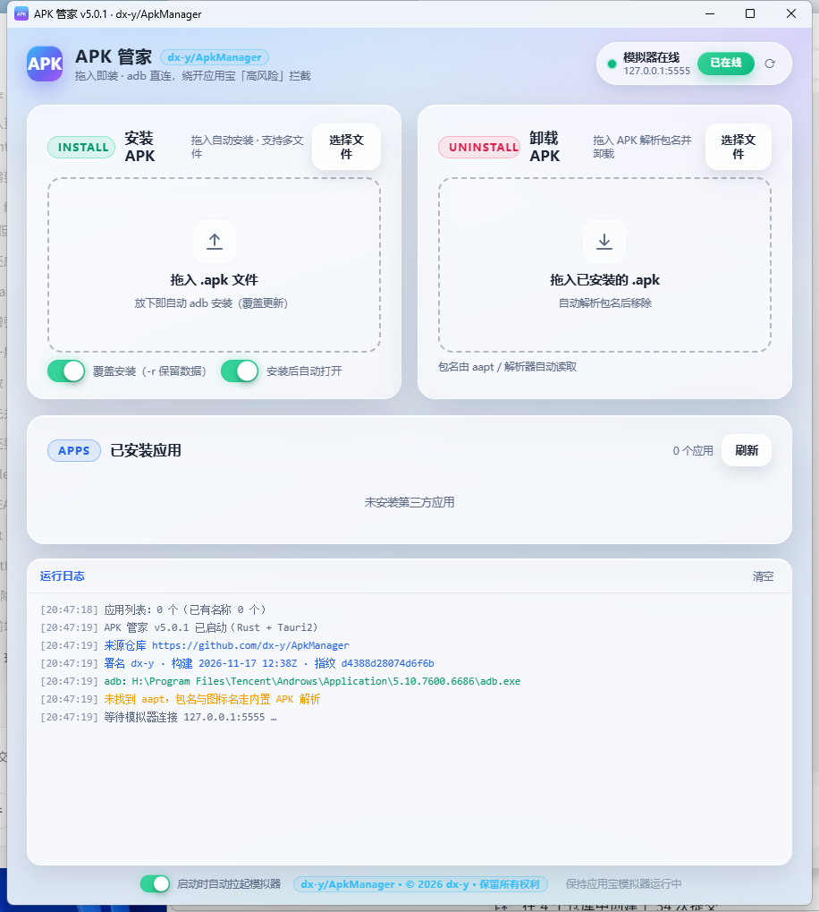
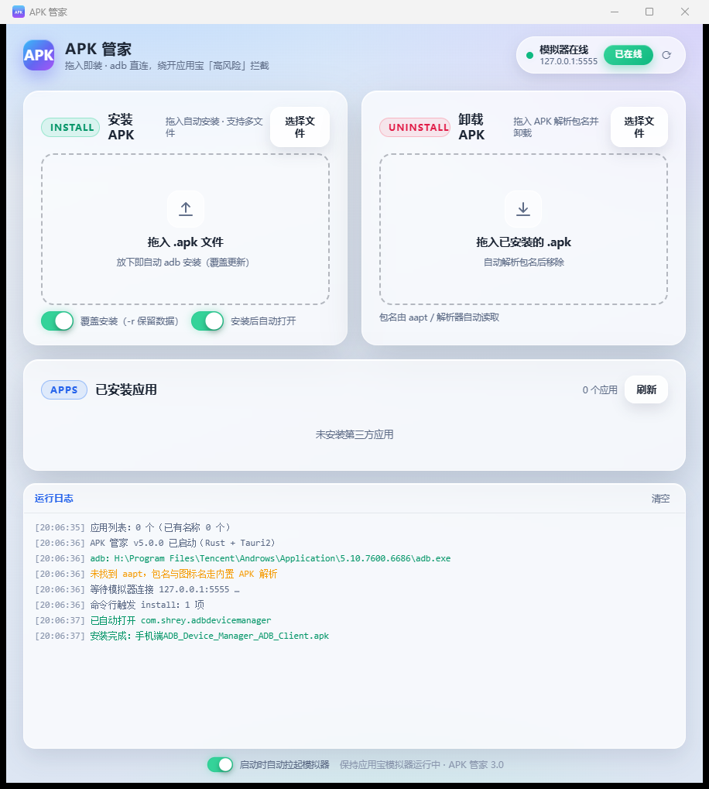

# APK 管家

把 APK 装进安卓模拟器，一个窗口就够：**拖进去就装，列表里点一下就卸**。



## 它解决什么问题

在 Windows 上用安卓模拟器跑自己打包或内测的 APK，常碰到三个麻烦：

| 麻烦 | APK 管家怎么做 |
|---|---|
| 在模拟器界面装第三方 APK，提示「来源不明 / 高风险」装不上 | 直连 `adb` 安装，不经过任何拦截层 |
| 手动装要自己找 adb、连端口、push、再 install，十几条命令 | 把 APK 拖进窗口，或点「选择文件」 |
| 自带应用卸不掉，报 `DELETE_FAILED_INTERNAL_ERROR` | 自动改用「从当前用户卸载」，并说明结果 |

## 使用场景

| 场景 | 怎么做 |
|---|---|
| 自研 / 内测包反复验证 | 重新打包后把新 APK 拖进去，覆盖安装；可勾选装完自动打开 |
| 一次装多个 | 多选文件一起拖入，逐个安装并汇总结果 |
| 清理模拟器自带应用 | 在「已安装应用」里选目标 → 卸载，桌面更清爽 |
| 微信收到的包 / 快捷方式 | 微信下载的 `.apk.1`、桌面 `.lnk` 快捷方式都能直接拖进来 |
| 写进脚本 | `apkmanager.exe --install app.apk`、`--uninstall 包名` |

## 下载

功能完全一样，按需选一个：

| 版本 | 文件 | 说明 |
|---|---|---|
| 安装版（推荐） | [release/ApkManager_5.0.1_x64-setup.exe](release/ApkManager_5.0.1_x64-setup.exe) | 双击安装，装到当前用户，不需要管理员权限 |
| 便捷版 | [release/ApkManager_5.0.1_x64-portable.exe](release/ApkManager_5.0.1_x64-portable.exe) | 免安装，放哪跑哪，可放 U 盘随身带 |

也可以到 Releases 页面下载。

## 怎么用

1. 先打开安卓模拟器（应用宝 PC 版 / 腾讯移动应用引擎）。
2. 打开 APK 管家，右上角状态灯显示「模拟器在线 127.0.0.1:5555」即可用；显示离线就点「启动模拟器」。
3. **安装**：把 APK 拖进「安装 APK」区，或点「选择文件」。勾选「自动打开」会在装完后直接启动该应用。
4. **卸载**：在「已安装应用」里点目标应用 → 卸载。



## 功能

- 拖放安装：`.apk`、微信 `.apk.1`、`.lnk` 快捷方式、多文件批量
- 安装前校验：文件存在、非空、大小上限、APK 文件头，避免推坏包
- 应用列表：显示第三方应用与中文名，名字解析一次后本地缓存，下次秒开
- 卸载：含模拟器自带应用的「从当前用户卸载」回退
- 一键启动模拟器、在线状态轮询
- 运行日志：面板内查看与清空，同时写 `%LOCALAPPDATA%\ApkManager\apkmanager.log`（超 2 MB 轮转）
- 命令行：`--install <apk>` / `--uninstall <包名>` / `--repo`（打印来源仓库与构建指纹）

## 出处与署名

本程序由 **dx-y** 编写，源码仓库：<https://github.com/dx-y/ApkManager>

仓库地址与署名在程序里有多处固定标记，不是界面贴图，无法通过改配置或删界面去掉：

| 位置 | 形式 |
|---|---|
| 窗口标题 | `APK 管家 v5.0.1 · dx-y/ApkManager` |
| 标题旁徽标、底栏 | 常驻显示仓库短名与版权行，被删改会自动回填 |
| 启动日志 | 首屏输出「来源仓库 https://github.com/dx-y/ApkManager」，每条安装 / 卸载任务日志首行带来源 |
| 命令行 | `apkmanager.exe --repo` 打印仓库地址、构建时间与指纹 |
| 文件属性 | 右键 exe → 属性 → 详细信息，可见作者、版权与仓库主页 |

字符串以混淆字节嵌入并在运行时解码，二进制里搜不到明文 URL；构建指纹可用于核对二进制是否出自本仓库：

```powershell
apkmanager.exe --repo
# 来源仓库 https://github.com/dx-y/ApkManager
# 署名 dx-y · 构建 2026-11-17 12:38Z · 指纹 d4388d28074d6f6b
```

## 系统要求

- Windows 10 / 11（x64）
- 腾讯移动应用引擎（应用宝 PC 版），模拟器监听 `127.0.0.1:5555`
- WebView2 运行时（Windows 11 自带；Windows 10 一般随 Edge 已有）

## 注意事项

1. 固定连接 `127.0.0.1:5555`，只面向本机的应用宝 / Androws 模拟器，暂不支持真机和其他端口。
2. 卸载模拟器自带应用时执行的是「从当前用户卸载」：桌面上消失，应用本体仍留在系统分区，恢复系统镜像后会回来。
3. 应用图标暂用「名称首字 + 色块」，未读取真实图标。
4. 程序只读取 `%LOCALAPPDATA%\ApkManager\settings.json`，不会覆盖你的配置；找不到 adb 时在该文件里填 `androws_root` / `adb`。

## 从源码构建

需要 Rust（stable msvc）、VS Build Tools、Node（仅用于调用 Tauri CLI）。

```powershell
npx tauri dev      # 开发运行
npx tauri build    # 产出 exe 与安装包
```

产物：

- `src-tauri/target/release/apkmanager.exe`
- `src-tauri/target/release/bundle/nsis/ApkManager_5.0.1_x64-setup.exe`

## 版本

- 5.0.1：加入仓库归属标记
- 5.0.0：首个版本
